  

   

  

    
    
    
    
  

---

## About

I'm a Grade 11 science student (Physical Group) at Kathmandu Model College in Kathmandu, and I build things for the web: websites, SaaS products, browser extensions and AI agents, with expertise in technical SEO, AEO and GEO. My work ships on my own domains at [jiteshprakash.com.np](https://jiteshprakash.com.np) (professional) and [jiteshprakash.info.np](https://jiteshprakash.info.np) (personal).

- **President, [Junior Empowerment Circle (JEC)](https://jec.jiteshprakash.com.np)** - 2026 executive board of a not-for-profit +2 student community
- **President, Paragon Foundation Club** - student club for tech, AI and innovation events
- **Published Chrome extension developer** - AuraTab is live on the Chrome Web Store
- **Hackathon winner** - Top Coder at Youth Fest by EU and Udaan
- Open to **subcontract and collaboration work** with other freelancers and teams

---

## Featured work

  
  
  
  
  
  
  
  
  

**AuraTab privacy:** No account and no developer-side analytics or tracking; optional online features call their own services only when you use them.

**Earlier experiments:** PJ PowerShell JARVIS - PowerShell experiments in command-line automation and AI assistance.

---

## Currently exploring

AI agents and LLM apps · robotics and embedded systems · electronics · cybersecurity (authorized lab practice)

---

## Tech I use

  

    
    
    
    
    
  

  

    
    
    
    
    
  

  

    
    
    
    
  

---

## Around the web

  
  
  
  
  
  

  
More links

  

    
    
    
    
    
    
    
  

---

## Contact

**Websites:** [jiteshprakash.com.np](https://jiteshprakash.com.np) · [jiteshprakash.info.np](https://jiteshprakash.info.np)

**Email:** info@jiteshprakash.com.np · info@jiteshprakash.info.np
